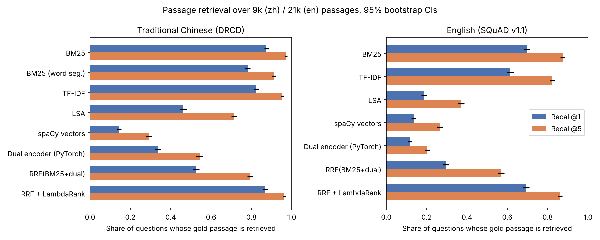

# Bilingual retrieval evaluation for RAG

How well do different retrievers find the right passage for Traditional Chinese and English questions, and are the differences real? This benchmark answers that for the retrieval step of a RAG system, with proper significance tests.

- **Chinese:** 3,493 DRCD questions over 9,014 passages
- **English:** 3,500 SQuAD v1.1 questions over 20,963 passages

The correct passage for each question comes from the human-labelled answer span, so no LLM is grading anything.



## Findings

**BM25 is hard to beat.** Recall@1 87.4% in Chinese and 69.8% in English (Recall@5 97.2% / 87.4%). Nothing else I tried did better.

**For Chinese, skip the word segmenter.** BM25 on single characters plus bigrams beat BM25 on spaCy word segmentation by 9.4 points of Recall@1 (87.4% vs 78.1%, McNemar with Holm correction, p < 1e-50).

**A dense encoder trained from scratch doesn't transfer.** My PyTorch dual encoder drove training loss from 1.87 to 0.09 but only reached 33.7% (zh) and 11.7% (en) Recall@1 on test. It memorised the training passages.

**Fusion only helps if both sides are good.** Combining BM25 with that weak encoder (reciprocal rank fusion) was 35 points worse in Chinese and 40 worse in English than BM25 alone.

**The reranker recovers the loss, but doesn't beat BM25.** LambdaRank over the fused top 30: 86.9% vs 87.4% (zh, p = 0.11) and 69.3% vs 69.8% (en, p = 0.38).

**Chunk size matters less than the context budget.** With 1,024 characters of context, 256-character chunks (top 4) reached 94.8%, vs 93.6% for 128 (top 8) and 91.9% for 512 (top 2).

**Language effects, modelled together.** A GEE logistic model of hit@5 with questions as clusters: Chinese questions have 5.0× the odds of a hit (p < 1e-44); the reranker's small deficit is larger in Chinese (interaction OR 0.84, p = 0.02).

Both datasets were written by people looking at the passage, so questions share a lot of words with their answers. That favours BM25. A pretrained multilingual embedding model (bge-m3, multilingual-e5) is the obvious next comparison; I couldn't download one in the environment I built this in. Anything with `fit(chunks)` and `score(queries)` plugs in.

## Method

- All test passages plus every training passage as distractors, so it's a real search, not a pick among a thousand passages.
- Recall@1/5/10 and MRR@10 per question, 95% bootstrap CIs, ties counted against the system.
- Each system vs BM25 with exact McNemar (recall) or a paired permutation test (MRR), Holm-corrected.
- No leakage: the dual encoder trains on 90% of training articles, the reranker on questions from the other 10%, and test questions are never seen.

## Layout

```
src/bireval/data.py        loaders, chunking, gold labels
src/bireval/text.py        tokenisers
src/bireval/retrievers.py  BM25, TF-IDF, LSA, spaCy vectors, dual encoder, RRF
src/bireval/rerank.py      LambdaRank reranker
src/bireval/metrics.py     recall, MRR, bootstrap, McNemar, Holm
src/bireval/generate.py    optional: answer with citations from Claude
scripts/run_eval.py        the benchmark
scripts/analyze.py         GEE model and figure
app/main.py                GET /search?q=...&lang=zh|en
```

## Run it

```bash
pip install -r requirements.txt
make data
make eval      # about 25 minutes on 4 CPU cores
make analyze
make test
make serve     # http://localhost:8000/docs
```

## Data

- **DRCD**: Traditional Chinese Wikipedia passages with human-written questions, from Delta Electronics.
- **SQuAD v1.1**: English Wikipedia passages with crowd-sourced questions; 3,500 dev questions sampled with a fixed seed.
